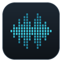
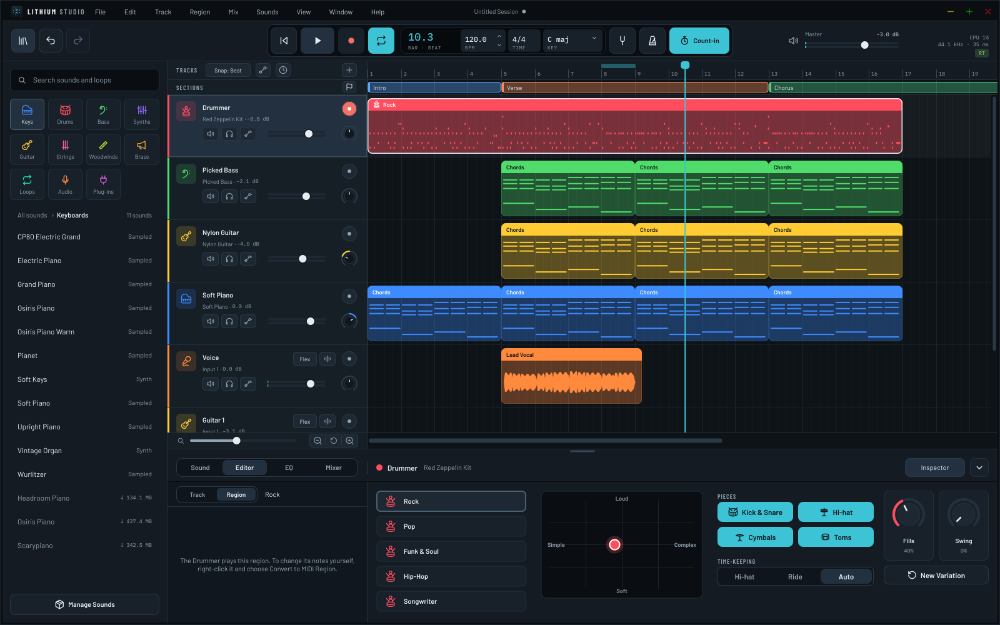
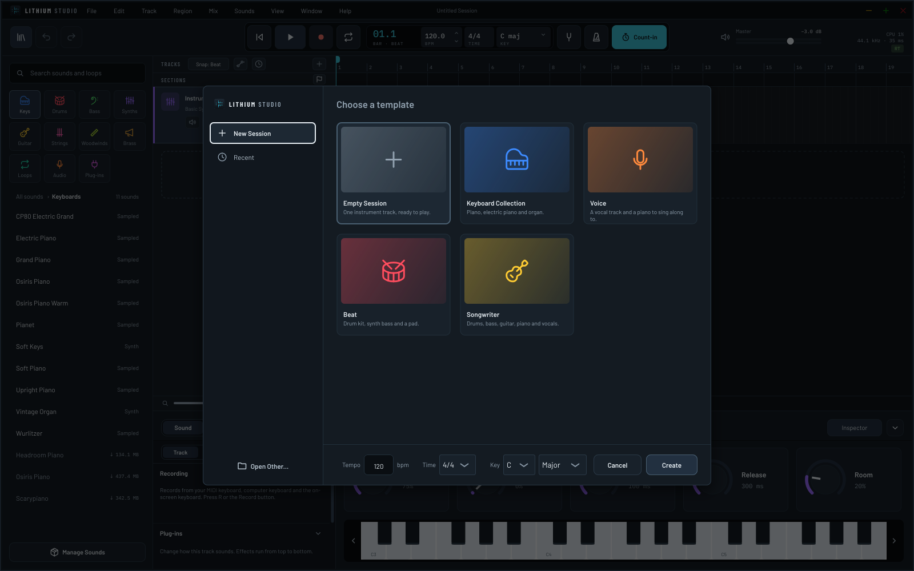
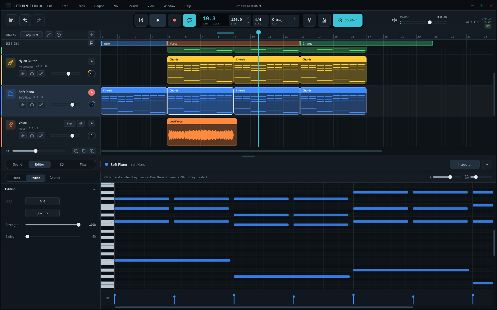
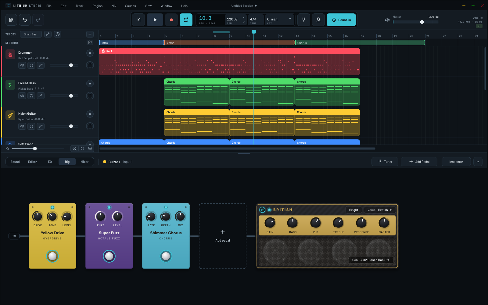
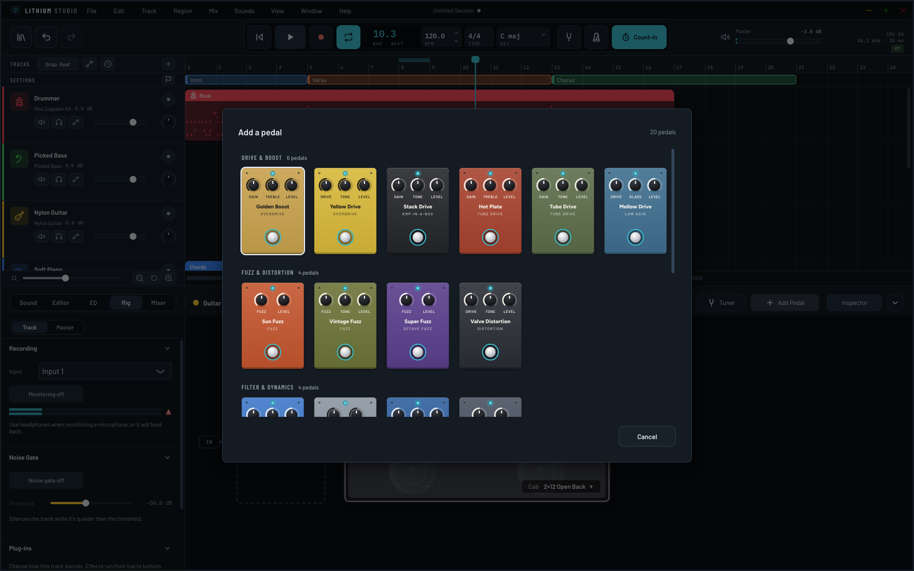
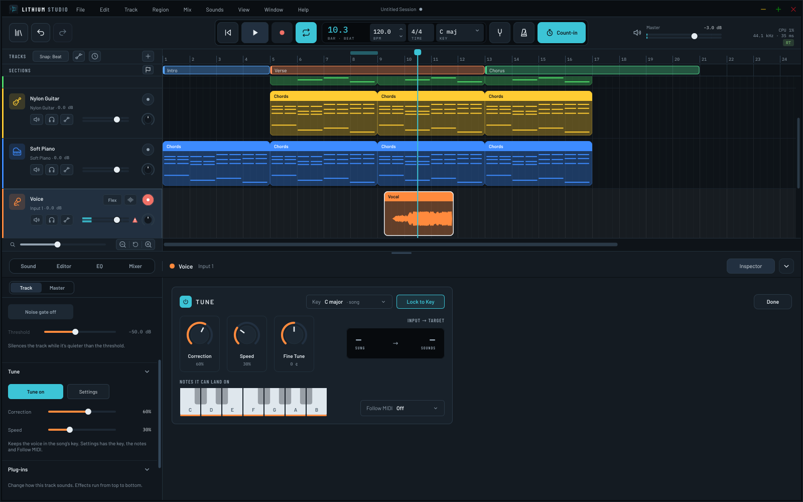
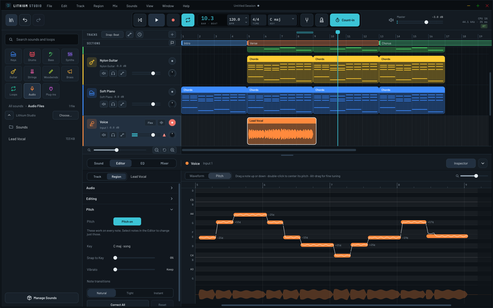
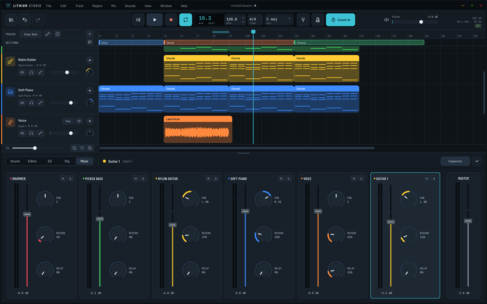
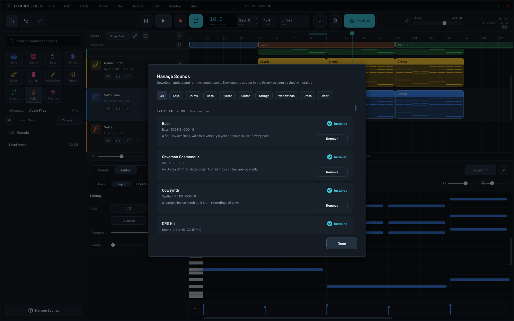

<p align="center"></p>

# Lithium Studio

**A free, open-source music studio for making songs.** Instrument and audio tracks, a virtual drummer, a guitar pedalboard and amp, pitch correction for vocals, and a library of sounds and loops, in the spirit of GarageBand.



Linux, Windows and macOS · Version 0.15.0 (alpha) · Free software, [GNU GPLv3 or later](LICENSE)

By Isaac Joseph ([Calamity Audio](https://github.com/thecalamityjoe87)).

## What it is

Lithium Studio is a studio for people who want to make a song without learning a big DAW first. You add tracks, play or record into them, drop in loops, and shape the sound with knobs that say what they do. Underneath, it's a real multitrack recorder built on Tracktion Engine and JUCE, with plug-in support, automation and stem export for when you want more.

It's the sibling of [Lithium Drums](https://github.com/thecalamityjoe87/LithiumDrums) and shares its look.

It's early software. Everything below works, but expect rough edges, and expect things to change before 1.0.

## What it can do

### Start a song



A new session starts from a template: an empty one with a single instrument, a keyboard collection, a voice track with a piano to sing along to, a beat, or a full songwriter band. Set the tempo, time signature and key before you start, or change them later. The tempo and time signature can also change partway through the song.

### Build it up

Add instrument, audio, vocal, guitar or bass, Drummer and Sampler tracks. Play into an instrument track from a MIDI keyboard, your computer keyboard or the on-screen keyboard, or double-click its lane to get a 4-bar chord region to build on. Record a microphone, a guitar or a stereo source, with a count-in if you like. Drag in loops from the library: they follow the session's key and tempo.

Mark the song's sections (intro, verse, chorus) above the tracks, then drag a section to move its music on every track, or Alt-drag to copy it. Regions can be split, trimmed, faded, duplicated, reversed and transposed.

### Play with a drummer

Add a Drummer track and a virtual drummer plays along. Pick Rock, Pop, Funk & Soul, Hip-Hop or Songwriter, drag the puck between simple and complex, soft and loud, choose which pieces play, whether it keeps time on the hi-hat or the ride, and how often it fills and how much it swings. It plays grooves real drummers recorded for Google's Groove MIDI Dataset and puts a fill before each section marker. Its region turns into an ordinary MIDI region whenever you'd rather edit the notes yourself.

### Edit notes



The piano roll edits notes and their velocities, with quantize (strength and swing) for notes, and for audio too: turn on Flex for an audio track to drag the hits in a recording to new places, with the audio in between stretching to fit, or quantize them onto the grid like notes.

### Plug in a guitar



Guitar and bass tracks get a Rig: a pedalboard you can reorder by dragging, followed by an amp. The amp has six voices (Clean, Crunch, Chime, British, High Gain and Bass), each with its own tone controls and speaker cabinet, which you can swap or turn off. There's a tuner in the display, and a noise gate for noisy pickups.



There are twenty pedals, from boosts, overdrives and fuzzes to an auto-wah, a compressor, a chorus, a flanger and a spring reverb. Most of their sound comes from GxPlugins, Guitarix and KlonCentaur, each one checked against the original, and the amp is built from Guitarix's amp models and cabinets.

### Tune a vocal



Tune keeps a voice in the song's key as you sing, from a gentle nudge to a hard, robotic snap. Choose which notes it can land on, or let it follow the notes of a MIDI track instead.



For more control, turn on Pitch for an audio region and the editor shows each sung note on a row of its own, with how far off it is. Drag a note to a new pitch, double-click it to center it, snap the whole take to the key or smooth out its vibrato, and Reset takes it back to how it was sung.

### Mix it



Every track has a fader, pan and sends to a shared reverb and delay, plus an EQ and its own chain of effects (a compressor, limiter, gate, EQ, filter, distortion, reverb, echo, chorus, phaser, tremolo and pitch shift are built in). Draw automation to change them over the course of the song. When you're done, export the song or each track as WAV, FLAC, OGG or MP3.

### Find more sounds



The library has instruments by category, loops, your own audio files and plug-ins. The app comes with Lithium Basics, a small set made from scratch, and more sound packs are a click away: packs that aren't installed are listed in their category with a download button, and Sounds > Manage Sounds... lists every pack to download, update or remove. With a free Freesound API key, the loop browser also searches Freesound for loops you're allowed to use.

### Use your gear

VST3 and LV2 plug-ins work on Linux and Windows, and VST3 and Audio Units on macOS. Plug-ins are scanned in a separate helper process, so one that crashes or freezes is skipped (and remembered) instead of taking the app down. Mix > Plug-ins... shows what was found and can scan again.

MIDI controllers from Akai, Alesis, Arturia, Korg, M-Audio, Nektar, Novation and others are mapped out of the box, and control surfaces that speak Mackie Control drive the faders, transport and track selection.

## Install

Download the installer for your system from the [Releases](https://github.com/thecalamityjoe87/ikaros-studio/releases) page:

- **Linux:** unpack `Lithium_Studio-<version>-linux-x86_64.tar.gz` and double-click "Install Lithium Studio". It installs into your home folder (no password), adds Lithium Studio to your app menu, opens `.lisession` files from your file manager, and can download the Starter sounds (piano, drums, bass, guitar and strings, about 380 MB). Run it again to update or remove it. There's also an AppImage.
- **Windows:** run `Lithium_Studio-<version>-windows-setup.exe`, or unpack the zip.
- **macOS:** open `Lithium_Studio-<version>-macos.pkg`, or the disk image. It runs on macOS 12 and later.

The installers aren't signed yet, so Windows may show a SmartScreen warning ("More info", then "Run anyway") and macOS asks before opening the app the first time (open it once, then choose Open Anyway in System Settings › Privacy & Security).

## Your sessions

A saved session is a single `.lisession` file: it holds the session and every recording, loop and audio file it uses, so you can move it, back it up or send it to someone on Linux, Windows or macOS. Instruments from sound packs aren't copied into it; the session finds them by pack on whichever computer opens it.

While you work, the app keeps its own recovery copy of the session a few seconds after you stop making changes, and recordings go to disk as you play. Your saved file only changes when you save. If the app crashes, it offers to bring back your unsaved work the next time it starts, including a take that was cut short.

Recordings line up with the music on their own: the app allows for the delay of your audio interface. If the audio device stops or changes, or the disk fills up, in the middle of a take, recording stops and keeps what you played so far, and the app tells you what happened. It also lets you know when your input was too loud.

Lithium Studio used to be called Ikaros Studio. The first time it starts, it moves Ikaros Studio's settings, session folder and sound packs to their new names. Sessions saved before the rename (`.iksession` files) open as they are, and saving writes back to the same file. Sessions saved as folders by earlier versions still open too, and saving one writes a `.lisession` next to its folder.

## License and credits

Lithium Studio is Copyright (C) 2026 Isaac Joseph. It is free software: you can redistribute it and/or modify it under the terms of the GNU General Public License as published by the Free Software Foundation, either version 3 of the License, or (at your option) any later version. The full text is in [LICENSE](LICENSE). It comes with no warranty.

It's built on Tracktion Engine (GPLv3 or later) and JUCE (AGPLv3), and the other projects listed in [CREDITS](CREDITS), each under its own license: sfizz, Rubber Band, LAME, miniz, GxPlugins, Guitarix, KlonCentaur, fat1 and others. The Drummer's grooves are from the Groove MIDI Dataset (CC BY 4.0), and the controller maps are converted from Ardour's MIDI maps. Sound packs carry their own licenses, listed in each pack's `pack.json`. Barlow, Barlow Condensed, IBM Plex Mono and Figtree are under the SIL Open Font License (see `resources/fonts`). Some instrument icons are from [Lucide](https://lucide.dev) (ISC License; the notice is in `src/ui/widgets/Icons.cpp`).

## Development

### Building

You need CMake 3.22+ and a C++20 compiler. Tracktion Engine (which includes JUCE) lives in `external/tracktion_engine`, sfizz, which plays SFZ instruments, in `external/sfizz`, miniz, which reads and writes session files, in `external/miniz`, Rubber Band, which stretches loops to the song's tempo and key, in `external/rubberband`, the DSP behind the pedals in `external/gxplugins` and `external/kloncentaur`, and behind the amp in `external/guitarix`. The first build takes a while because it compiles all of them.

```sh
git clone --recursive https://github.com/thecalamityjoe87/ikaros-studio.git
cd ikaros-studio
```

#### Linux

On Debian/Ubuntu:

```sh
sudo apt install build-essential cmake ninja-build pkg-config \
    libasound2-dev libjack-jackd2-dev libfreetype-dev libfontconfig1-dev \
    libx11-dev libxcomposite-dev libxcursor-dev libxext-dev libxinerama-dev \
    libxrandr-dev libxrender-dev libxi-dev libgl1-mesa-dev libcurl4-openssl-dev libsystemd-dev

cmake -B build -G Ninja -DCMAKE_BUILD_TYPE=Release
cmake --build build
./build/LithiumStudio_artefacts/Release/Lithium\ Studio
```

`sudo cmake --install build` installs the binary, desktop file, metainfo, icons and the sound packs.

Debug builds draw a lot slower, so resizing feels choppy. Use `RelWithDebInfo` for day-to-day work; it's fast and relinks much quicker than `Release`.

#### Windows

Visual Studio 2022 with the C++ desktop workload. From a Developer PowerShell:

```powershell
cmake -B build -G "Visual Studio 17 2022" -A x64
cmake --build build --config Release
```

#### macOS

Xcode, plus CMake (`brew install cmake`).

```sh
cmake -B build -G Xcode
cmake --build build --config Release
open "build/LithiumStudio_artefacts/Release/Lithium Studio.app"
```

That builds for your Mac's own processor. sfizz can't be built for Apple Silicon and Intel at once, so `packaging/macos/build-dmg.sh` builds each separately and joins them into one app.

### Sounds

The library's sampled instruments and loops come in sound packs: plain folders with an `instrument.json` per instrument and a `loops.json` for loops (see `src/engine/SoundLibrary.h`). Lithium Basics, the pack that ships with the app, is made by `tools/generate_sounds.py`, so there are no third-party samples in the repo. To add a pack by hand, drop its folder into `Documents/Lithium Studio/Sounds`. The downloadable packs are built by `tools/packs/build_packs.py` and hosted as release files of [lithium-sounds](https://github.com/thecalamityjoe87/lithium-sounds).

### Tests

There's a small engine test, off by default:

```sh
cmake -B build -DLITHIUM_BUILD_TESTS=ON
cmake --build build
ctest --test-dir build
```

Add `-DLITHIUM_BUILD_TEST_PLUGINS=ON` to also build a few tiny VST3/LV2 plug-ins (and two deliberately broken ones) that the test scans and loads. They end up in `build/TestPlugins`, never in your real plug-in folders. The test keeps its own settings, so it doesn't touch the app's.

### Packaging and installers

Each system has its own script in `packaging/`, to make a package yourself on that system:

| System | Package | Built by |
|---|---|---|
| Linux | `Lithium_Studio-<version>-linux-x86_64.tar.gz`: the graphical installer (`tools/installer/`) with the files it installs | `packaging/linux/build-installer.sh` |
| Linux | AppImage | `packaging/appimage/build-appimage.sh` |
| Windows | `Lithium_Studio-<version>-windows-setup.exe` (Inno Setup, `packaging/windows/LithiumStudio.iss`) and a zip | `packaging/windows/build-installer.ps1`, `build-zip.ps1` |
| macOS | `Lithium_Studio-<version>-macos.pkg` and a universal disk image | `packaging/macos/build-pkg.sh`, `build-dmg.sh` |

Pushing a version tag (`git tag v0.15.0 && git push origin v0.15.0`) makes GitHub build all of them and put them in a draft release to check and publish. The workflow is in `.github/workflows/release.yml`, and it can also be started by hand from the Actions tab; its comments list the secrets that turn on macOS signing and notarization. The installers look like Lithium Drums' ones; their artwork is drawn by `tools/make_installer_art.py`.

The manifest in `packaging/flatpak` is a starting point, not ready for Flathub yet.
